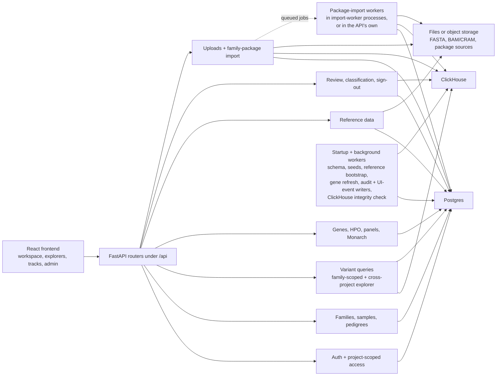

# Application Scheme

How CoGA is put together: its parts, which database holds what, what happens on a request
and at startup, and where to find the code. Every table is described in
[database.md](database.md); the Google Cloud setup is in [deployment-gcp.md](deployment-gcp.md).

## Storage boundary

Postgres is authoritative for metadata and state. ClickHouse is authoritative for variant
payloads.

- **Postgres** holds the users and their project access; species, assemblies, chromosomes,
  genes and the other reference data; families, samples, pedigrees and their projects;
  reviews, classifications, tags and filter presets; repeat expansions, Paraphase results and
  the NIPT artifact list; gene panels, HPO and Monarch data; the sequencing-QC limits and
  their append-only change history; the ranking cache; the source records of the interval
  tracks; and the traceability records: the annotation manifest, the append-only,
  hash-chained clinical audit and sign-out tables, and the integrity anchors. The schema is
  five idempotent baseline files in `backend/db/schema/postgres/` (`01_access.sql` to
  `05_grants.sql`) and the Alembic revisions in `backend/db/migrations/versions/`, recorded in
  the ledger table `alembic_version` ([database.md](database.md#schema-migrations)).
- **ClickHouse** holds, for each assembly, the small variants (details, annotations and their
  indexes, the per-sample calls in `entries`, and per-family summaries), the structural
  variants and CNVs, and the interval tracks: coverage, a capture panel's per-target
  coverage, copy-number segments, APCAD, PCF APCAD segments and haplotypes. The SQL file in
  `backend/db/schema/clickhouse/` only creates the database. An assembly's tables are created
  the first time it is used, by `clickhouse_variant_storage.py` and
  `clickhouse_interval_tracks.py`.

[database.md](database.md) lists every table and the file that defines it. Metadata IDs are
UUIDs.

### Storage identity

A variant is known everywhere by its variant ID, a string that depends neither on the storage
nor on the callset. Reviews, classification evidence snapshots, the ranking cache and the
SV→gene index attach by it. A row in ClickHouse is one callset's call of one variant, in one
family and one project: its sort key ends with the callset (`source`). So a direct call and an
imputed call of one variant, or two callers' calls of one SV, are separate rows, and a part
merge keeps both. The diagnostic lists show the direct call, and the SV list shows an SV once
per caller. The backend refuses to start on a table whose sort key leaves the callset out, and
on a small-variant calls table without the per-call `calls.filters` and `calls.metrics`
columns. The sort keys, how the storage keys are built and the recovery steps are in
[database.md](database.md#row-identity).

## Runtime flow

1. The browser calls the API under `/api`. Locally the frontend server, or the Vite dev
   server, forwards these calls to the backend; on Google Cloud the load balancer sends
   `/api` to the backend service.
2. The backend identifies the user and checks the requested family, sample or project
   against the user's projects in Postgres.
3. Metadata, reference, gene, HPO and panel endpoints, and the Gene Explorer, read from
   Postgres only.
4. Variant endpoints read the family's records from ClickHouse and join the review state
   (classifications, tags, notes) back from Postgres. The Global Small Variant Explorer
   counts carriers straight from the `entries` tables of every project the user can access,
   at query time.
5. Uploads and package imports write metadata to Postgres and the variant and interval rows
   to ClickHouse, and record each source file with its SHA-256 checksum (an alignment that
   stays in a bucket with the bucket's record of it instead). Alignments (BAM/CRAM) and
   package sources are read from the local disk or from object storage (S3 or Google Cloud
   Storage), as `STORAGE_BACKEND` sets. A package in a bucket is copied for the import except
   its alignments, which the genome browser reads from the bucket. The writes of one family's
   variants (uploads, package imports, and the admin, PED and structure-change deletes) run one
   at a time: each holds the family's write lock in Postgres from its first read of the rows it
   replaces until it commits, whichever worker or process runs it
   ([database.md](database.md#one-write-at-a-time-per-family)).
6. Sign-out freezes the report's content, with the software and reference versions, into an
   append-only, hash-chained record ([clinical-traceability.md](clinical-traceability.md)).

## Startup and background work

On start the backend (`backend/app/main.py`):

1. waits for Postgres, migrates its schema (the baseline files, then the revisions its ledger
   lacks) and makes sure the admin user exists. With
   `POSTGRES_RUN_SCHEMA_MIGRATIONS_ON_STARTUP=false` it skips this, so that the schema can be
   applied separately and the API can run as the restricted database role
   ([db-runtime-role-runbook.md](db-runtime-role-runbook.md)), and only reads the ledger: it
   refuses to start unless the database is at its own schema revision
   ([database.md](database.md#schema-migrations));
2. starts the writers for the audit log and the UI events;
3. seeds the built-in repeat catalogue; makes sure GRCh38 exists, with its cytobands (from
   UCSC) and gene loci (from GENCODE, or the UCSC gene track when GENCODE cannot be fetched);
   imports T2T-CHM13 as well when `REFERENCE_BOOTSTRAP_T2T` is set; loads the HPO ontology if
   none is loaded; loads GRCh38's segmental duplications from the shipped file (into a GRCh38
   assembly only; no clinical CNVs, which the knowledgebase rebuild loads); and queues the
   first gene-reference sync when the local dbNSFP gene file is present and no gene
   information is cached;
4. waits for ClickHouse and creates the database; refuses to start when a variant table's sort
   key leaves the callset out, or the small-variant calls table lacks the per-call FILTER and
   metrics columns ([Storage identity](#storage-identity)); drops the backup tables of
   `overwrite` imports that no running import owns, left by one whose process stopped
   ([database.md](database.md#clickhouse-tables)); and starts the scheduled ClickHouse
   integrity check;
5. starts the gene-reference refresh worker and the family-package import workers
   (`FAMILY_IMPORT_WORKER_COUNT`; with 0 it starts none and leaves the jobs to
   [import-worker processes](#import-worker-processes), as Docker Compose does).

All of this runs inside the one uvicorn process that serves the API.

### Import-worker processes

`python -m app.import_worker` ([import_worker.py](../backend/app/import_worker.py)) runs the
family-package import workers in a process of its own, without the API: it serves nothing and
listens on no port. Docker Compose runs it as the `import-worker` service, from the backend's
image, with the backend's settings and its `/data`, and starts the API with no import worker
(`FAMILY_IMPORT_WORKER_COUNT=0` on the `backend` service). Each replica is one process, which
runs `FAMILY_IMPORT_WORKER_COUNT` jobs at a time (1 by default); `IMPORT_WORKER_REPLICAS` (1 by
default) sets how many run. On Google Cloud the imports still run in the API's instances:
`terraform/` has no worker service.

On start it checks what the API's start checks before its workers run, and does nothing else:

1. waits for Postgres and refuses to start unless the database is at this version's schema
   revision. It never migrates; Compose starts it once the backend, which migrates, is healthy;
2. waits for ClickHouse, creates the database when it is missing, and refuses variant tables
   whose sort key leaves the callset out or that lack the per-call columns
   ([Storage identity](#storage-identity));
3. drops the backup tables of `overwrite` imports that no running import owns;
4. starts its workers.

On SIGTERM (`docker compose stop`) or SIGINT it stops its workers as the API's shutdown does,
closes its database clients and exits 0. An import it was running stops where it is, and the
next worker to look takes the job over once its heartbeat is stale
([data-import.md](data-import.md#the-import-job)). A start that fails, or a worker that ends
by itself, exits 1, and Compose starts the process again.

What the workers of all processes share goes through Postgres, so it holds across processes
and hosts as it does between the workers of one process: the claim of a job
(`FOR UPDATE SKIP LOCKED`: one worker per job), its heartbeat, stamped and judged stale by the
database's clock, the end of a job whose heartbeat went stale, and the family's variant-write
locks, advisory locks on the import's own connection, which Postgres releases with it
([database.md](database.md#one-write-at-a-time-per-family)). The context variable those locks
keep only spares the import's own tasks from taking the locks they hold already; another
process never sees it, and takes the locks. An import's self-stop and its check of the locks'
connection run in its own process. The clinical audit trail and the pedigree's structure
versions an import writes are written in its own transactions, each chain under its family's
advisory lock; the request that queued the job is audited by the API. A worker logs each job
it claims with its worker ID, which starts with its process ID: a job's record names its
worker only while the job runs.

Measured with two synthetic one-sample families of 30,000 records each (three VEP CSQ entries
per record), imported at once into Postgres 16 and ClickHouse 26.8 containers. The machine had
10 cores and was shared, with a load average of 11 to 15 from other work. There were three
runs, in both orders:

| Layout | Both families imported | CPU time of each process |
| --- | --- | --- |
| One process, two workers | 25 to 33 s (median 29 s) | 18 to 21 s |
| Two processes, one worker each | 19 to 21 s (median 20.5 s) | 11 s |

The one process used about two thirds of its one core and waited on the databases for the
rest, which its two workers already overlap. The gain grows with the share of an import that
is CPU work and with the cores left free.

## Performance

The API and the refresh worker share that process's one event loop, and so do the import
workers when the API runs them ([import-worker processes](#import-worker-processes) run them
apart), so CPU work a request or an import runs on the loop holds every other request until it
ends. These run in a worker thread instead (`asyncio.to_thread`), the queries and writes on the
loop, each giving the result it gave on the loop (OPS-9):

- **Sample QC**: the read of the sampled sites' genotypes, their parse (each distinct genotype
  string parsed once) and the checks (relatedness over every pair, Mendelian, sex).
- **Small-variant VCF uploads and imports**: the file is read and its lines parsed a batch at a
  time (`variant_upload_service._read_off_the_event_loop`), and each batch's rows are built for
  the insert. The loop awaits each insert and progress report before the reader reads on, so an
  upload holds one batch, as before; a cancelled upload waits for its reader's batch before it
  cleans up. The family's write lock, the check of a file before it replaces stored rows and the
  upload's mark are unchanged.
- **NIPT sign-out**: the family's NIPT analysis, which the Sample QC's NIPT checks and the
  record's NIPT section both read, runs once per snapshot (`nipt_service.SharedNiptAnalysis`).

Measured on synthetic data with Postgres and ClickHouse faked (each ClickHouse write awaits
2 ms), main and this change alternated on a shared 10-core machine (Python 3.13), the median of
6 runs; the longest stall is the longest wait of a coroutine that wakes every millisecond:

| Work | Before: time / longest stall | After: time / longest stall |
| --- | --- | --- |
| Sample QC of ten samples (90,000 autosomal and 20,000 chrX sites) | 2.90 s / 2.90 s | 1.28 s / 0.05 s |
| VCF upload of 50,000 records (a trio, VEP-annotated, gzipped) | 9.4 s / 0.21 s, 50 stalls over 50 ms | 9.5 s / 0.04 s, none over 50 ms |
| NIPT sign-out snapshot of 50,000 sites | 1.74 s, the analysis run twice | 0.95 s, run once |

The results were the same before and after: the frozen Sample QC, every row written and every
progress report, and the record's Sample QC and NIPT section. What is left of a stall is a
garbage collection, which stops every thread. How the ClickHouse storage and its queries
scale towards 1,000 whole genomes, where they fail and the hardware they need is measured in
[clickhouse-scale-benchmark.md](clickhouse-scale-benchmark.md). Not done: the refresh worker in
a process of its own, and import-worker processes on Google Cloud, where the imports still run
in the API's instances; the Variant Explorer's unfiltered page, which aggregates every carrier
(#841) and which that benchmark finds the first query to fail; the ranked view's limit of 5,000
SVs, which a family with more than 50,000 SVs reaches more often since #906.

### Small-variant import

A whole-genome SNV import took 2 h 49 min (the public GIAB HG002 long-read package: 10.76
million records, 5.37 million stored, about 530 a second). It was profiled with a synthetic,
seeded VCF shaped like that callset: one sample, DeepVariant's RefCall and NoCall records
(half of them) left out, VEP CSQ entries (2.8 per stored record). The import ran through the
package import as the import worker runs it, into Postgres 16 and ClickHouse 26.8 containers of
its own. Of a 200,000-record import (100,000 stored, 50 s), reading the lines and their CSQ
entries took 12 s, building the five tables' rows 19 s and the inserts 18 s, one after the
other. Three changes, none to what is stored:

- each annotation is read once for its `annotations` row and its variant's `annotation_index`
  and `gene_index` rows, and serialized once for both hashes (before, its population
  frequencies were read ten times and it was serialized twice);
- a CSQ or ANN entry is read by the alias tables narrowed to the fields its header declares, and
  a record's INFO without an annotation field is not read;
- the variant tables are written as synchronous inserts ([database.md](database.md#inserts-are-synchronous)):
  each batch had waited for ClickHouse's async-insert timer once per table.

Main and the change on the same 1,000,000-record file (500,004 records stored), on a shared
10-core machine that other work was loading:

| | Before | After |
| --- | --- | --- |
| Time | 394 s | 179 s |
| CPU time of the process | 238 s | 127 s |
| Records stored a second | 1,270 | 2,790 |
| ClickHouse's time answering the inserts | 107 s, 45 s of it async-insert flushes | 27 s |
| Event-loop lag, 99th percentile / longest | 51 ms / 594 ms | 35 ms / 357 ms |

Every table held the same rows before and after: the count and a checksum of each, with the
run's family and project UUIDs and the write times left out. The progress reports, the
dataset's summary and the job log were the same too. The check fixes `PYTHONHASHSEED`: the
annotation index's effect and ClinVar term arrays are gathered from Python sets, so their order
follows the process's hash seed, before as after.

What is left is CPU. The imports of one process share its one GIL, so they use one core
together, whatever `FAMILY_IMPORT_WORKER_COUNT` says; in the API's process they share it with
the requests too. So the import workers run in [import-worker processes](#import-worker-processes)
of their own, one core each, and the API runs none (Docker Compose; not yet on Google Cloud).
A process pool inside one import would speed up that import alone, and would end the reader's
one-batch bound (above).

## Main code areas

Backend, under `backend/app/`:

- `core/` — shared runtime code: settings, the Postgres and ClickHouse clients, Azure
  sign-in, logging, object storage, and timeouts and retries for outbound requests.
- `routers/` — the API, registered in `routers/__init__.py`.
- `services/access_control.py`, `services/family_metadata_context.py` — the project-scoped
  access check that every family and sample request passes, with each member's level there
  (an analyst reads and changes the project's records, a reader only reads them).
- `services/metadata_service.py` — families, samples and projects.
- `services/clickhouse_family_variants.py`, `services/clickhouse_variant_queries.py` —
  family-scoped variant queries and filters; `services/variant_explorer_service.py` — the
  cross-project explorer; `services/variant_ranking_cache.py` — the phenotype-prioritised
  ranking cache.
- `services/family_package_*.py` — the folder-based family-package import;
  `import_worker.py` — its workers in a process of their own;
  `services/variant_upload_service.py` and `services/bed_service.py` — single-file uploads;
  `services/family_variant_write_lock.py` — one write at a time to each family's variants.
- `services/acmg_points.py`, `services/cnv_acmg_points.py` — ACMG/AMP scoring for small
  variants and CNVs.
- `services/annotation_manifest_service.py`, `services/classification_drift_service.py`,
  `services/report_signout_service.py`, `services/clinical_audit_service.py`,
  `services/hash_chain.py`, `services/integrity_anchor_service.py` — traceability and
  sign-out.
- `services/nipt_*.py` — monogenic NIPT; `services/haplotype_lineage_service.py` and
  `services/phased_marker_service.py` — PGT haplotypes; `services/sample_integrity_*.py` —
  sample QC.
- `services/gene_metadata_service.py`, `services/hpo_service.py`, `services/monarch_*.py` —
  the Gene Explorer, HPO and Monarch.
- `services/repeat_expansion_pg.py`, `services/paraphase_pg.py`,
  `services/mitochondrial_analysis.py` — repeat expansions, Paraphase and mtDNA.

Frontend, under `frontend/src/`: `pages/` for the screens, `components/visualizations/` for
the tracks and plots, `lib/api.ts` and `lib/apiPath.ts` for API calls, and `content/docs/` for
the in-app user guide and reference docs.
